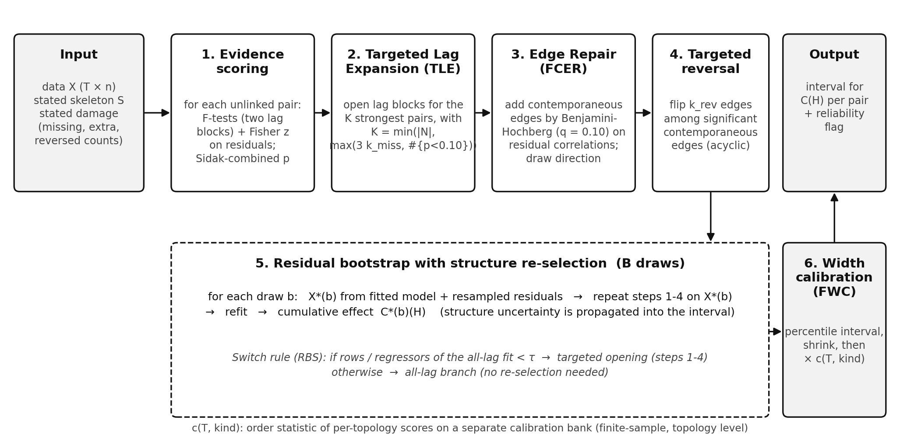

# Báo cáo xử lý phản hồi của các thầy (buổi họp 13/11/2026)

Cập nhật ngày 19/11/2026. Báo cáo này trình bày những gì nhóm đã làm để đáp ứng phản hồi của các thầy, nhằm để các thầy xem xét trước khi nhóm viết lại bài. Phần lớn kết quả mang tính thăm dò (exploratory). Riêng các kết quả được ghi là "xác nhận" đã được chạy đúng một lần trên tập topology kiểm tra chưa dùng cho đại lượng đó, với hệ số và tiêu chí được ghi trước khi chạy. Các ngưỡng đạt hay không đạt trong báo cáo do nhóm tự đặt, không phải chuẩn bên ngoài.

Phương pháp được gọi là STRIDE (Skeleton-Tolerant Re-selecting Intervals for Dynamic Effects), kèm bước hiệu chỉnh độ rộng ở mức topology. Trong các tài liệu đã đóng băng trước đó, phương pháp mang tên SRCI.

## Điều kiện đủ để coverage đúng

Trước đây hệ số nới độ rộng là một phân vị gộp ở mức cặp, tính trên khoảng 20 topology. Hệ số này nhắm tới độ phủ trung bình quanh 0,95 trên mọi cặp, nhưng không bảo đảm điều gì cho từng topology. Kiểm tra trên 20 topology cũ cho thấy hệ số đó xấp xỉ trung vị của điểm theo đơn vị, nghĩa là khoảng một nửa số topology vẫn vượt mức trượt mong muốn.

Nhóm phát biểu lại bảo đảm ở mức topology. Mỗi topology (cùng toàn bộ phần ngẫu nhiên bên trong nó) là một đơn vị. Điểm của đơn vị là hệ số nhỏ nhất sao cho không quá β = 10% số cặp phi-null bị trượt, lấy giá trị lớn nhất trên hai mức hỏng. Hệ số hiệu chỉnh là thống kê hạng của các điểm này trên N topology hiệu chỉnh. Có hai cách chọn hạng k0. Ở phiên bản biên, k0 = ⌈(N+1)(1−δ)⌉ với δ = 0,10; khi các topology hiệu chỉnh và kiểm tra hoán vị được, xác suất điểm của một topology mới không vượt hệ số này ít nhất là k0/(N+1). Ở phiên bản PAC, k0 là giá trị nhỏ nhất sao cho phân phối Beta(k0, N+1−k0) tại 0,90 không quá 0,05; khi đó có độ tin cậy 0,95 (theo mẫu hiệu chỉnh) rằng ít nhất 90% topology mới đạt ngưỡng, và cần N ≥ 59.

Điều kiện hoán vị được bảo đảm bằng cách xây dựng tập topology. Nhóm sinh 1.200 topology độc lập từ cùng một bộ sinh và chia ngẫu nhiên thành ba phần: thiết kế (100), hiệu chỉnh (550) và kiểm tra (550). Một tập thí điểm gồm 360 topology (60/150/150) được dùng để chọn quy tắc và viết mã; phần kiểm tra của tập này chỉ được mở một lần, để chấm cờ độ tin cậy ở lag 1. Ở các tập cũ, tập hiệu chỉnh và tập kiểm chứng là các tập cố định nên không có cơ sở hoán vị như vậy.

Mệnh đề chỉ áp dụng cho topology mới cùng họ bộ sinh, trong kịch bản sạch, hỏng một loại và khai báo đúng. Nó không nói gì về từng cặp riêng lẻ, về dữ liệu thật, về nhiễu đuôi dày hay về khai báo sai. Bản phác thảo chứng minh do một nhóm phản biện nội bộ soạn và chưa được thẩm định bởi người ngoài.

Kết quả xác nhận được đo trên 550 topology kiểm tra cho từng lag, với hệ số đóng băng và tiêu chí ghi trước. Mức bảo đảm là tỉ lệ topology có không quá 10% số cặp phi-null bị trượt, với mục tiêu 0,90.

| Lag | Ô có hệ số hữu hạn | Tỉ lệ topology đạt ngưỡng: luật cũ / phân vị biên / PAC | Ô mà khoảng tin cậy chạm 0,90 | Tiêu chí (cần ≥ 80% số ô) |
|---|---|---|---|---|
| 1 | 20/20 | 0,805 / 0,897 / 0,918 | 17/20 (85%) | đạt |
| 2 | 12/16 | 0,805 / 0,890 / 0,912 | 9/12 (75%) | không đạt |
| 3 | 8/12 | 0,801 / 0,888 / 0,906 | 8/8 | đạt |

So với luật cũ, trên cùng các ô có hệ số hữu hạn, khoảng tin cậy rộng hơn ×1,18, ×1,14 và ×1,10 và interval score cao hơn 11%, 6% và 3% (lần lượt ở lag 1, 2, 3, với hệ số biên). Phiên bản PAC rộng hơn khoảng 5% so với phiên bản biên.

Ở lag 2, tiêu chí ghi trước không đạt (75% so với 80%). Theo đặc tả, nhóm rút tuyên bố bảo đảm ở ba ô không đạt: T = 80 thừa cạnh, T = 80 đảo cạnh và T = 150 đảo cạnh; cận trên nhỏ nhất ở lag 2 vẫn là 0,880. Ở lag 2 với T = 30 và lag 3 với T = 40, phương pháp từ chối đưa ra đảm bảo (abstain) vì từ 9% đến 92% số lượt fit thất bại. Ngay tại các ô này, luật cũ vẫn trả về một khoảng tin cậy nhưng chỉ 7% đến 76% topology đạt ngưỡng (thấp nhất là 7% ở lag 3, T = 40, thiếu cạnh). Vì vậy hệ số mới đồng thời đóng vai trò một chỉ báo cho biết khi nào không nên tin khoảng tin cậy. Ở các ô đạt, tỉ lệ topology đạt ngưỡng nằm quanh 0,89–0,90, xấp xỉ mục tiêu và không dư, với sai số lấy mẫu của 550 topology khoảng ±0,025. Toàn bộ kết quả này dùng một bộ sinh, 14 nút, 21 cạnh và nhiễu Gaussian sạch.

## Hệ số 0,5

Hệ số co (pre-shrink) κ là hằng số nhân vào nửa độ rộng của khoảng bootstrap trước bước hiệu chỉnh, nên khoảng cuối cùng là trung điểm ± κ·c·(nửa độ rộng). Với κ = 0,5, nửa độ rộng bị co xuống một nửa; về bản chất κ là một hệ số tỉ lệ, và κ lớn hơn 1 sẽ làm khoảng rộng ra thay vì co lại. Hằng số này được thêm vào vì lưới hiệu chỉnh cũ chỉ cho phép nới (từ 1,0), trong khi ở T nhỏ khoảng bootstrap vốn đã quá rộng. Không có cơ sở lý thuyết nào dẫn tới đúng giá trị 0,5. Nếu κ được áp dụng giống hệt nhau ở hiệu chỉnh và kiểm tra thì khoảng cuối cùng chỉ phụ thuộc vào tích κ·c, nên bảo đảm ở mục 2 không phụ thuộc vào giá trị này.

Nhóm kiểm độ nhạy bằng cách hiệu chỉnh theo quy tắc cũ trên tập hiệu chỉnh và đánh giá trên tập thiết kế.

| Hệ số co κ | Hệ số hiệu dụng | Số ô chạm sàn lưới | Coverage | Interval score |
|---|---|---|---|---|
| 0,25 | 1,424 | 0/20 | 0,951 | 5,24 |
| 0,5 | 1,435 | 0/20 | 0,952 | 5,26 |
| 1,0 | 1,460 | 0/20 | 0,955 | 5,33 |
| 2,0 | 2,000 | 20/20 | 0,988 | 6,55 |

Với κ từ 0,25 đến 1,0, kết quả gần như trùng nhau và chênh lệch chủ yếu do làm tròn của lưới. Với κ = 2, lưới chạm sàn nên khoảng tin cậy quá rộng. Như vậy giá trị 0,5 không quan trọng miễn là sàn của lưới không bị chạm, và nhóm đề xuất bỏ hằng số này, dùng hệ số là thống kê hạng chính xác (không qua lưới) như ở mục 2.

## T nhỏ nhất và mức hỏng mà phương pháp còn chạy được

Trên tập 1.200 topology (mục 2), hệ số bảo đảm hữu hạn từ T = 19 ở lag 1, từ T = 40 ở lag 2 và từ T = 80 ở lag 3. Dưới các ngưỡng này (lag 2 với T = 30, lag 3 với T = 40), tỉ lệ fit thất bại nằm trong khoảng 9% đến 92% và phương pháp từ chối đưa ra đảm bảo. Như vậy T tối thiểu tăng theo số lag, phù hợp với bản đồ thăm dò đã có từ trước (19, 40 và 80 cho lag 1, 2 và 4).

Phần quét theo mức hỏng chỉ được chạy ở lag 1, trên 60 topology thiết kế của tập thí điểm (T ∈ {19, 30, 40, 80, 150}, mức hỏng từ 0,1 đến 0,8, ba loại hỏng, 14 nút và 21 cạnh). Quy tắc ghi trước: một ô được coi là dùng được nếu fit thành công ở ít nhất 95% số lượt và coverage của các cặp phi-null tại hệ số hiệu chỉnh đạt ít nhất 0,90. Với thiếu cạnh, phương pháp dùng được ở mọi T đã thử, kể cả T = 19 ở mức hỏng 0,8. Với thừa cạnh và đảo cạnh, phương pháp dùng được từ T = 30 ở mọi mức đến 0,8; ở T = 19, thừa cạnh thất bại từ mức 0,7 (tỉ lệ fit thành công 0,92 rồi 0,87) và đảo cạnh thất bại từ mức 0,5 (tỉ lệ thành công từ 0,92 xuống 0,88).

Kết quả quét này có một số hạn chế. "Thành công" chỉ có nghĩa là bước fit hoàn tất, coverage chỉ được tính trên các lần fit thành công, và interval score chưa được so với oracle. Coverage cao (0,96 đến 0,99) là hệ quả của việc hệ số được chọn thận trọng ở mức topology. Đơn vị có số cạnh đảo bằng 0 ở mức hỏng thấp được xếp vào ô không hỏng và được loại khỏi phép tính tỉ lệ thành công. Dữ liệu từ một nhánh phát triển khác của nhóm (khai báo sai mức hỏng) cho thấy khi khai báo gấp đôi số cạnh thiếu ở mức 50%, chỉ có 5 đến 11 trong 60 lượt chạy được; nhóm đã tái lập một phần kết quả này nhưng chưa đưa vào bài.

## Sơ đồ phương pháp

{width=100%}

## Mô phỏng

Nhóm đã viết bộ sinh tập topology có tham số (số topology, kích thước từng phần) và tạo hai tập mới gồm 360 và 1.200 topology, so với 40 topology trước đây. Các thực nghiệm đã chạy ở lag 1, 2 và 3 (mục 2).

Để kiểm tra khi nhiễu không còn là Gaussian, nhóm giữ nguyên hệ số đóng băng và chạy lại trên các topology kiểm tra ở lag 1 với nhiễu động học Student-t bốn bậc tự do hoặc Laplace, phương sai bằng 1. Đây là các kịch bản vi phạm giả định Gaussian sạch và không nằm trong phạm vi bảo đảm.

| Nhiễu | Tỉ lệ topology đạt ngưỡng: luật cũ / biên / PAC | Số ô chạm 0,90 | Độ rộng trung bình (biên) |
|---|---|---|---|
| Gaussian (xác nhận) | 0,805 / 0,897 / 0,918 | 17/20 | 4,86 |
| Student-t(4) | 0,824 / 0,909 / 0,927 | 18/20 | 5,25 |
| Laplace | 0,812 / 0,901 / 0,921 | 17/20 | 6,29 |

Hệ số hiệu chỉnh trên Gaussian vẫn giữ tỉ lệ topology đạt ngưỡng ở mức 0,90 khi nhiễu động học đổi dạng, với khoảng tin cậy rộng hơn đôi chút (Laplace rộng hơn 29%).

Kết quả khác hẳn khi thêm sai số đo, tức nhiễu cộng thêm vào dữ liệu quan sát với phương sai bằng 10% hoặc 30% phương sai của mỗi cột.

| Sai số đo | Tỉ lệ đạt ngưỡng: luật cũ / biên / PAC | Dải giữa các ô (biên) | Coverage theo cặp (biên) |
|---|---|---|---|
| Không | 0,805 / 0,897 / 0,918 | 0,86 đến 0,93 | 0,971 |
| 10% | 0,642 / 0,776 / 0,810 | 0,53 đến 0,93 | 0,948 |
| 30% | 0,363 / 0,501 / 0,544 | 0,03 đến 0,88 | 0,878 |

Bảo đảm không chịu được sai số đo, và tình hình xấu hơn khi T lớn (với nhiễu 10%, T = 150 chỉ còn 0,53 đến 0,59), vì sai lệch do sai số đo không giảm khi có thêm dữ liệu. Kết quả này nhất quán với các thử nghiệm sơ bộ của một nhóm khác, trong đó coverage giảm xuống 0,66 đến 0,75. Đây là một hạn chế thật của phương pháp và bài cần nêu rõ. Hướng khắc phục (chẳng hạn ước lượng tỉ lệ nhiễu đo rồi nới khoảng, như nhánh adapt của kho mã gốc) chưa được đánh giá đầy đủ nên chưa đưa vào. Nhóm mong nhận ý kiến của các thầy về việc có nên thêm một tập topology với số nút khác 14 hay không.

## Tài liệu từ 2021 trở đi

Nhóm đã kiểm chứng 79 mục (trong đó 69 mục từ 2021 trở đi), phân bố theo chủ đề như sau: conformal (17), IRF và SVAR (18), suy luận sau khi chọn mô hình hoặc khi đồ thị sai (10), học cấu trúc chuỗi thời gian (10), FDR (9), interval score (5), VAR trên dữ liệu Việt Nam (7) và sai số đo (3). Hai chủ đề còn mỏng là sai số đo trong mô hình nhân quả chuỗi thời gian và các nghiên cứu về Việt Nam. Việc kiểm chứng chủ yếu dựa trên Crossref; nhóm chưa đọc từng bài. Danh mục nằm ở `docs/latex/references_2021.bib` và đã được nối vào bản thảo.

## Dữ liệu thực tế

Việc thu số liệu thật từ nguồn công khai không khả thi với công sức hợp lý. Một thăm dò nhỏ (3 ngân hàng × 2 quý) chỉ mở được 1 trong 6 tài liệu: báo cáo ACB quý 3/2024 là ảnh quét nên phải OCR (số đọc khá tốt, nhãn bị méo), MBB chặn truy cập bằng cơ chế chống bot, và trang nhà đầu tư của VCB tải danh sách bằng JavaScript nên không có đường dẫn trực tiếp. Ước tính thu đủ 14 ngân hàng × 19 quý mất 80 đến 150 giờ (dựa trên một tài liệu, chưa đo), tự động hóa được tối đa khoảng 30%, và điều khoản sử dụng chưa được kiểm chứng. Vì vậy phần ngân hàng của panel vẫn là dữ liệu mô phỏng hiệu chỉnh (7 biến) và bài phải khai báo rõ điều này. Nếu nhà trường có cơ sở dữ liệu tài chính trả phí, việc xuất dữ liệu một lần có thể thay thế cho cách làm thủ công.

Trên panel hiện có (14 biến, 19 quý, skeleton 21 cạnh, hệ số mới, 5 hạt giống bootstrap, 3 mức khai báo), khoảng tin cậy của cả 10 cặp được chọn trước, ở mọi mức khai báo và mọi hạt giống, đều chứa 0. Các cặp giữa hai biến quan sát được (lãi suất chính sách tới lợi suất cổ phiếu, tới GDP và tới CPI; CPI tới khối lượng giao dịch) là dữ liệu thật; các cặp có biến ngân hàng chỉ mang tính minh họa. Khoảng tin cậy rộng ra khi khai báo nhiều cạnh thiếu hơn: ví dụ với cặp lãi suất chính sách tới lợi suất cổ phiếu, độ rộng là 0,92 khi không hỏng, 4,4 khi thiếu 20% và 7,3 khi thiếu 50%. Nói cách khác, 19 quý quá ngắn để xác định dấu của bất kỳ hiệu ứng nào trong các cặp đã chọn; phương pháp phản ánh đúng mức bất định đó thay vì tạo ra một kết quả có ý nghĩa kinh tế.

Để biết phương pháp hoạt động ra sao trong đúng vùng của panel, nhóm fit một mô hình động lên panel, coi nó là ground truth, sinh 400 chuỗi với T = 19 và n = 14, rồi làm hỏng skeleton ở ba mức (không hỏng, thiếu 20% và thiếu 50%).

| Khai báo | Phương pháp | Coverage theo cặp phi-null | Tỉ lệ lần sinh có ≤10% cặp trượt | Độ rộng trung vị | Fit thành công |
|---|---|---|---|---|---|
| Không hỏng | RB plug-in | 0,904 | 0,620 | 1,87 | 400/400 |
| Không hỏng | STRIDE | 0,990 | 0,990 | 3,64 | 400/400 |
| Thiếu 20% | RB plug-in | 0,663 | 0,000 | 1,70 | 400/400 |
| Thiếu 20% | STRIDE | 0,981 | 0,959 | 5,09 | 390/400 |
| Thiếu 50% | RB plug-in | 0,291 | 0,000 | 1,45 | 400/400 |
| Thiếu 50% | STRIDE | 0,993 | 0,978 | 13,94 | 359/400 |

"RB plug-in" là phương pháp đối chứng: residual bootstrap (RB) cắm thẳng (plug-in) skeleton khai báo vào mô hình như thể nó đúng. Nó nhận cùng skeleton đã bị làm hỏng như STRIDE nhưng không nghi ngờ, không sửa cấu trúc và không dùng mức hỏng. STRIDE thì ngược lại: coi skeleton là giả thuyết có thể sai, kiểm tra và sửa nó trước khi dựng khoảng tin cậy. STRIDE giữ coverage ở mức 0,98 đến 0,99 trong khi RB giảm xuống 0,29 khi thiếu 50% cạnh. Tuy nhiên, khi thiếu cạnh, một số lần sinh cho khoảng rộng đột biến (độ rộng trung bình lên tới vài trăm đến vài nghìn, trong khi trung vị chỉ từ 5 đến 14) và 10% lần fit thất bại ở mức thiếu 50%. Với T = 19 và 11 cạnh thiếu, bài toán gần như vô định, và các thầy cần lưu ý điều này khi đọc phần ứng dụng. Kết quả dựa trên một ground truth duy nhất nên không phải bảo đảm theo topology, và panel gốc có 7 biến là mô phỏng.

Phương án bán mô phỏng neo vào số thật mà nhóm từng cân nhắc chưa được xây dựng. Vì các cột của panel được chuẩn hóa z-score, việc neo mức trung bình và độ lệch chuẩn không làm thay đổi kết quả của phương pháp; chỉ cấu trúc theo thời gian mới có ảnh hưởng, mà số điểm thật để neo lại rất ít. Mô phỏng theo panel ở trên đã thay thế phương án này.

## Cấu trúc bài đề xuất

Nhóm đề xuất thứ tự sau: Giới thiệu, Công trình liên quan, Bài toán, Phương pháp (kèm hình architecture), Bảo đảm lý thuyết, Thiết lập mô phỏng, Kết quả chính (so sánh, tác động của mức hỏng, ablation), Case study (dữ liệu thật), Thảo luận và Kết luận. Khảo sát khoảng 80 bài ở Computational Statistics (qua bản arXiv) cho thấy mẫu phổ biến nhất là phần mô phỏng chiếm tỉ trọng chính, kèm một section ứng dụng dữ liệu thật ngắn. Nhóm chưa thấy bài về SVAR nào ở tạp chí này, nên mức độ phù hợp phạm vi cần các thầy xác nhận.

## Các điểm cần ý kiến của các thầy

Nhóm mong các thầy cho ý kiến về năm điểm. Thứ nhất, mức bảo đảm mong muốn: phiên bản biên hay phiên bản PAC (PAC rộng hơn khoảng 5% so với biên ở các ô đạt). Thứ hai, dữ liệu ngân hàng: có nên đầu tư 80 đến 150 giờ để thu số liệu thật, hay chấp nhận dữ liệu bán mô phỏng với khai báo rõ ràng. Thứ ba, có nên mở rộng sang kích thước khác (số nút, số cạnh) hay không. Thứ tư, tên phương pháp và thứ tự các section. Thứ năm, mức phù hợp với phạm vi của Computational Statistics, vì chưa thấy bài về SVAR cùng tạp chí.

## So sánh với các phương pháp tham chiếu ở cùng mức đảm bảo

Mỗi phương pháp được hiệu chỉnh bằng cùng một quy tắc (thống kê hạng theo topology, β = 10%, δ = 10%) trên cùng 150 topology hiệu chỉnh, rồi chạy một lần trên 200 topology kiểm tra (lag 1, T = 40 và 150, bốn loại hỏng). Khi đó các phương pháp đạt cùng mức đảm bảo (tỉ lệ topology đạt ngưỡng quanh 0,90) và có thể so sánh bằng độ rộng và interval score.

| Phương pháp | Số ô (trên 8) có IS thấp nhất | So cặp với STRIDE (8 ô): STRIDE tốt hơn / phương pháp đó tốt hơn |
|---|---|---|
| BVAR-Minnesota | 4 | 4 / 4 |
| STRIDE | 3 | không áp dụng |
| PSel-Union (ngân sách bootstrap gấp 32) | 1 | 7 / 1 |
| PSel, Full VAR, TLP | 0 | 8 / 0 cho mỗi phương pháp |

STRIDE có interval score thấp nhất ở các ô thiếu cạnh và đảo cạnh (T = 40 cho cả hai loại, T = 150 cho đảo cạnh). BVAR-Minnesota thấp nhất ở các ô không hỏng và thừa cạnh ở cả hai giá trị T. PSel-Union thấp nhất ở T = 150 với thiếu cạnh, nhưng dùng ngân sách tính toán gấp 32 lần. Hai phương pháp không đạt mức đảm bảo ở một ô: BVAR-Minnesota ở T = 150 thiếu cạnh (0,84) và PSel-Union ở T = 150 đảo cạnh (0,81). Kết quả này không ủng hộ nhận định trước đây rằng STRIDE tốt hơn ở 27/28 so sánh, vì khi đó mỗi phương pháp dùng hệ số riêng. Ở cùng mức đảm bảo, lợi thế của STRIDE vẫn có thật nhưng hẹp hơn và tập trung ở các loại hỏng cần mở cấu trúc. Phép so sánh chỉ gồm lag 1, hai giá trị T và 200 topology kiểm tra (khoảng tin cậy của tỉ lệ khoảng ±0,04); một số phương pháp tham chiếu là bản do nhóm chuyển thể, và STRIDE nhận số cạnh thiếu khai báo.

Để đo riêng phần lợi thế đến từ thông tin khai báo, nhóm chạy thêm một biến thể không dùng số cạnh thiếu khai báo, hiệu chỉnh theo cùng quy tắc và chạy một lần trên 200 topology kiểm tra. Ở bảy trong tám ô, interval score của biến thể chênh với STRIDE trong khoảng từ −0,10 đến +0,17; riêng ô T = 40 với thiếu cạnh, interval score tăng từ 4,69 lên 9,95, kém cả BVAR-Minnesota (6,13). Như vậy số cạnh thiếu khai báo là thông tin có giá trị chủ yếu khi T nhỏ và có cạnh thiếu; ở các ô còn lại, kết quả so sánh không phụ thuộc nhiều vào thông tin đó. Khoảng tin cậy của tỉ lệ topology đạt ngưỡng chạm 0,90 ở bảy trong tám ô, trừ T = 150 đảo cạnh (0,834, khoảng [0,775; 0,883]).

## Cờ độ tin cậy

Cờ độ tin cậy là một bộ phân loại: với mỗi cặp phi-null, nó dự đoán xem khoảng tin cậy cuối cùng có trượt giá trị thật hay không. AUROC là xác suất cờ cho một cặp bị trượt điểm cao hơn một cặp được phủ, chọn ngẫu nhiên; giá trị 0,5 tương đương đoán ngẫu nhiên và 1 là phân loại hoàn hảo. Nhóm dùng AUROC vì chỉ khoảng 3% số cặp bị trượt, nên độ chính xác thông thường không có nhiều ý nghĩa.

Phiên bản 1 là một mô hình gradient boosting dùng các đặc trưng quan sát được (độ rộng, tỉ lệ |trung điểm| trên nửa độ rộng, khoảng có chứa 0 hay không, mức hỏng khai báo, đường đi trong skeleton khai báo, độ rộng trung vị theo hàng và cột, thứ hạng độ rộng trong lượt chạy, tỉ lệ số dòng trên số biến hồi quy, v.v.). Mô hình được huấn luyện chỉ trên tập hiệu chỉnh (kiểm định chéo theo topology), đóng băng rồi chấm một lần trên 592.412 cặp của tập kiểm tra.

| Nhóm T | AUROC cờ mới | AUROC cờ cũ | Hiệu [khoảng tin cậy 95%] | Cặp trượt nhiều gấp (top 10%) |
|---|---|---|---|---|
| Tất cả | 0,869 | 0,792 | +0,077 [+0,065; +0,088] | 5,74 |
| 19–30 | 0,928 | 0,821 | +0,107 [+0,082; +0,134] | 7,33 |
| 40 | 0,882 | 0,868 | +0,014 [+0,010; +0,018] | 6,13 |
| 80–150 | 0,776 | 0,744 | +0,032 [+0,026; +0,038] | 3,96 |

Ngưỡng nhóm đặt trước là tăng ít nhất 0,03 AUROC ở cả ba nhóm T với khoảng tin cậy nằm trên 0. Ngưỡng này không đạt vì nhóm T = 40 chỉ tăng 0,014, do cờ cũ ở đó vốn đã mạnh (0,868). Cờ mới cải thiện rõ ở T nhỏ và cải thiện vừa phải ở T lớn, nơi AUROC vẫn chỉ khoảng 0,78.

Phiên bản 2 sửa hai lỗi đặc trưng của phiên bản 1 (số cạnh khai báo bị ghi bằng 0, và skeleton chỉ tính cạnh cùng kỳ), dùng một mô hình chung cho lag 1, 2 và 3, và được chấm một lần cho mỗi lag trên tập chưa dùng cho cờ. Đặc tả được viết trước khi đọc dữ liệu.

| Lag | T 19–30 | T 40 | T 80–150 | Ngưỡng (mỗi nhóm T hơn ≥ 0,03) |
|---|---|---|---|---|
| 1 | 0,924 / 0,808 (+0,115) | 0,885 / 0,870 (+0,015) | 0,786 / 0,737 (+0,049) | không đạt (T = 40) |
| 2 | không có (từ chối) | 0,894 / 0,865 (+0,028) | 0,790 / 0,737 (+0,053) | không đạt (T = 40, thiếu 0,002) |
| 3 | không có (từ chối) | không có (từ chối) | 0,790 / 0,731 (+0,059) | đạt |

Mỗi ô ghi AUROC của cờ mới / cờ cũ. Cờ mới hơn cờ cũ ở mọi nhóm T với khoảng tin cậy nằm trên 0, nhưng mức tăng ở T = 40 nhỏ vì cờ cũ ở đó đã đạt khoảng 0,87. Việc sửa hai lỗi đặc trưng không làm đổi kết luận của phiên bản 1.

Bảng sau cho AUROC theo từng kịch bản ở lag 1 (cờ mới / cờ cũ); trong mỗi ô thừa, thiếu và đảo cạnh, hai giá trị lần lượt ứng với mức hỏng 0,2 và 0,5.

| T | Không hỏng | Thừa cạnh | Thiếu cạnh | Đảo cạnh |
|---|---|---|---|---|
| 19 | 0,932 / 0,918 | 0,943 / 0,938; 0,940 / 0,921 | 0,915 / 0,840; 0,954 / 0,530 | 0,981 / 0,477; 0,966 / 0,667 |
| 30 | 0,894 / 0,878 | 0,888 / 0,872; 0,889 / 0,875 | 0,875 / 0,861; 0,856 / 0,848 | 0,907 / 0,897; 0,912 / 0,901 |
| 40 | 0,892 / 0,875 | 0,869 / 0,854; 0,907 / 0,881 | 0,868 / 0,852; 0,859 / 0,858 | 0,889 / 0,872; 0,910 / 0,892 |
| 80 | 0,808 / 0,771 | 0,828 / 0,798; 0,840 / 0,803 | 0,796 / 0,775; 0,781 / 0,772 | 0,877 / 0,841; 0,865 / 0,839 |
| 150 | 0,660 / 0,609 | 0,696 / 0,631; 0,696 / 0,635 | 0,686 / 0,661; 0,702 / 0,671 | 0,796 / 0,759; 0,815 / 0,773 |

AUROC giảm mạnh khi T lớn: khi không hỏng, giá trị này từ khoảng 0,93 ở T = 19 xuống còn 0,66 đến 0,70 ở T = 150, vì ở T lớn ít cặp bị trượt hơn và các cặp trượt giống các cặp được phủ hơn. Ở T = 19 với thiếu hoặc đảo cạnh, cờ cũ gần như vô dụng (0,48 đến 0,67) trong khi cờ mới đạt 0,92 đến 0,98. AUROC gần như không phụ thuộc vào mức hỏng (0,2 so với 0,5). Ở lag 2 và 3, xu hướng tương tự (chi tiết ở `results/ext_p4h8_flag_v2/test_eval_v2.md`). Các bảng trên bỏ qua những ô mà phương pháp từ chối đưa ra đảm bảo (lag 2 với T = 30, lag 3 với T = 40), vì ở đó không có khoảng cuối cùng để chấm.
